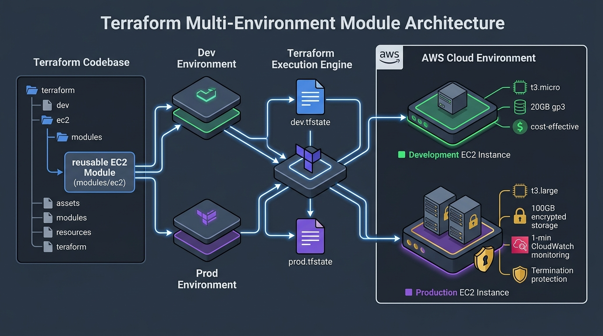

# 🚀 DevOps Terraform Labs

A well-structured, hands-on repository containing practical Terraform labs, reusable modules, and Infrastructure as Code (IaC) best practices for AWS.



---

## 📂 Repository Structure

```text
devops-terraform-labs/
├── .gitignore                           # Git ignore rules for state, cache, & secrets
├── README.md                            # Main project documentation
├── modules/                             # Reusable custom Terraform modules
│   └── ec2/                             # Reusable EC2 instance module
│       ├── main.tf                      # Resource definitions
│       ├── variables.tf                 # Module input variables
│       ├── outputs.tf                   # Module output values
│       └── versions.tf                  # Provider & Terraform version constraints
├── environments/                        # Multi-environment infrastructure
│   ├── dev/                             # Cost-optimized Development environment
│   └── prod/                            # High-durability Production environment
└── labs/                                # Topic-wise hands-on labs
    ├── 01-basics-first-ec2/             # AWS provider configuration & basic EC2
    ├── 02-variables-precedence/         # Variables, defaults, & tfvars precedence
    ├── 03-cross-referencing-attributes/ # Security groups, EIPs & resource references
    ├── 04-registry-modules/             # Consuming Terraform AWS Registry modules
    └── 05-team-environments/            # Team-based modular infrastructure (Team A)
        └── team-a/
```

---

## 🛠️ Environments & Labs Catalog

| Type | Directory | Description | Key Focus |
|---|---|---|---|
| **Environment** | [`environments/dev`](environments/dev/) | Development Environment | Cost optimization, `t3.micro`, auto-shutdown, basic monitoring |
| **Environment** | [`environments/prod`](environments/prod/) | Production Environment | High performance `t3.large`, termination protection, detailed monitoring |
| **Lab 01** | [`labs/01-basics-first-ec2`](labs/01-basics-first-ec2/) | Basic EC2 Provisioning | `aws` provider, `required_providers`, basic `aws_instance` |
| **Lab 02** | [`labs/02-variables-precedence`](labs/02-variables-precedence/) | Variable Precedence | Input variables, default values, `terraform.tfvars` order |
| **Lab 03** | [`labs/03-cross-referencing-attributes`](labs/03-cross-referencing-attributes/) | Attribute Cross-Referencing | Dynamic attributes, `aws_eip`, `aws_security_group`, implicit dependencies |
| **Lab 04** | [`labs/04-registry-modules`](labs/04-registry-modules/) | Registry Modules | Consuming official modules from Terraform Registry |
| **Lab 05** | [`labs/05-team-environments`](labs/05-team-environments/) | Team-Based Modules | Reusable custom modules (`modules/ec2`), team isolation |

---

## 📋 Prerequisites

1. **Terraform CLI**: `>= 1.0.0` ([Install Guide](https://developer.hashicorp.com/terraform/tutorials/aws-get-started/install-cli))
2. **AWS CLI**: Configured with credentials:
   ```bash
   aws configure
   ```
   *Alternatively, export environment variables:*
   ```bash
   export AWS_ACCESS_KEY_ID="<your-access-key>"
   export AWS_SECRET_ACCESS_KEY="<your-secret-key>"
   export AWS_DEFAULT_REGION="ap-south-1"
   ```

---

## ⚡ Quick Start

Navigate to any lab directory and run standard Terraform lifecycle commands:

```bash
# 1. Navigate to lab directory
cd labs/01-basics-first-ec2

# 2. Initialize provider plugins and modules
terraform init

# 3. Format and validate syntax
terraform fmt
terraform validate

# 4. Generate execution plan
terraform plan

# 5. Apply infrastructure changes
terraform apply

# 6. Destroy infrastructure when finished
terraform destroy
```

---

## 🔒 Security Best Practices

- **No Hardcoded Credentials:** Never store plaintext AWS Access Keys or Secret Keys in `.tf` files.
- **State File Protection:** `.tfstate` and `.tfstate.backup` are automatically excluded via `.gitignore`.
- **Secret Scanning:** GitHub push protection is enabled to guard against accidental secret commits.
